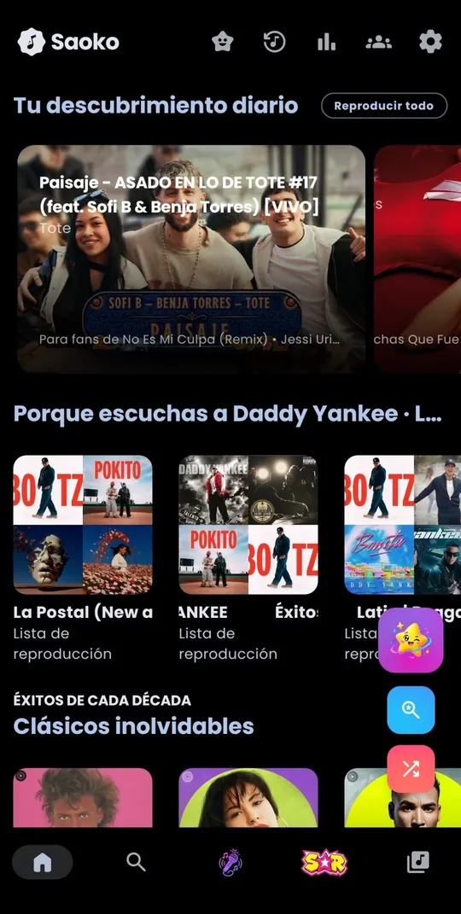
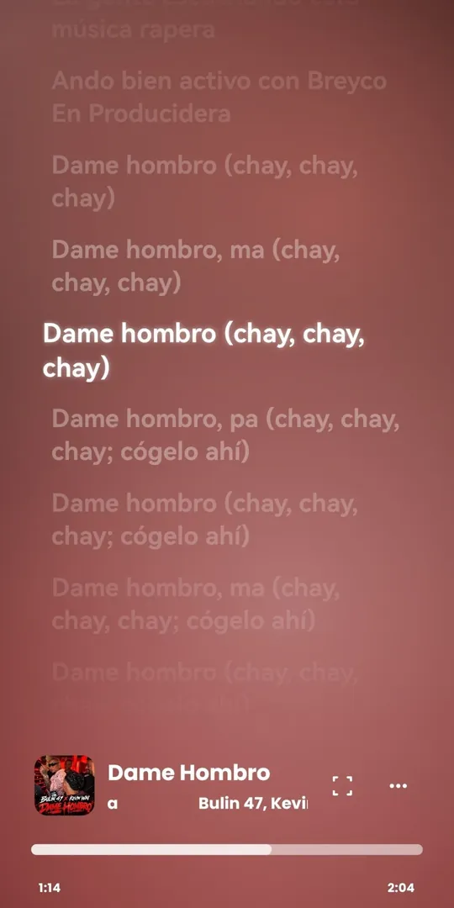
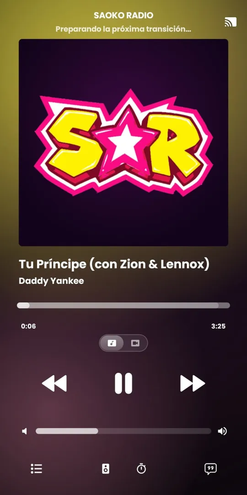
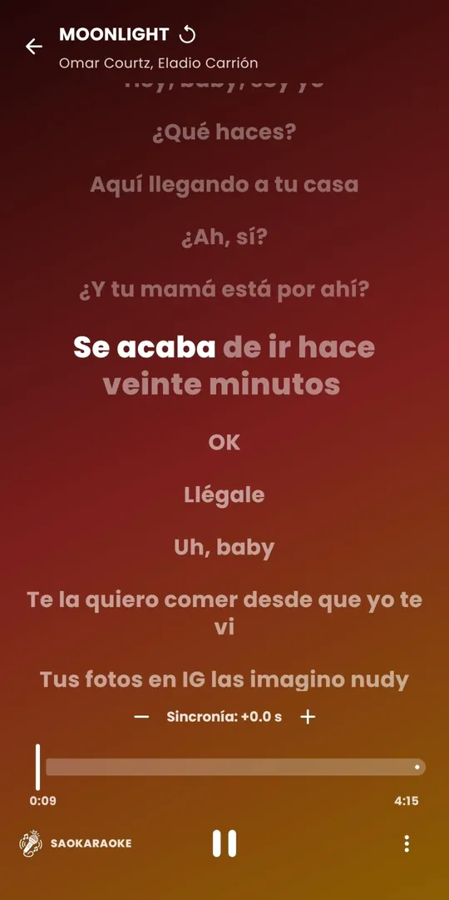
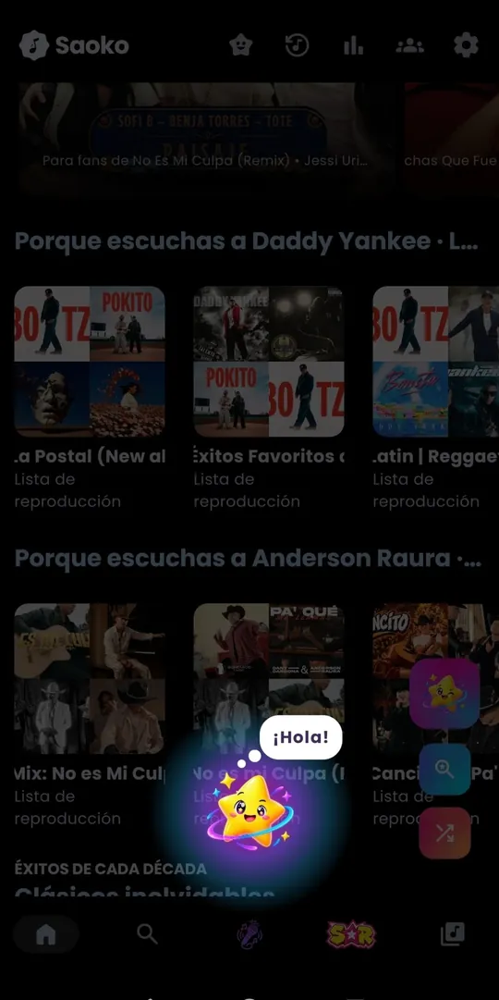
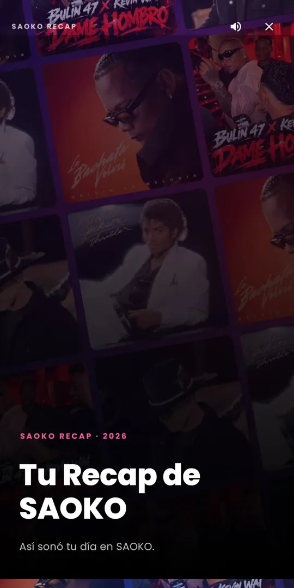
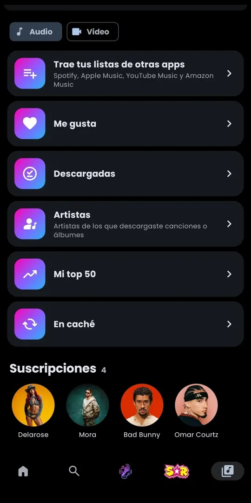

# SAOKO

**Tu música, a tu manera.** Radio con locutor, una IA a la que le hablas, karaoke de cualquier canción,
videos, letras en vivo y transiciones como de DJ. Gratis para Android.

[**⬇️ Descargar SAOKO Universal (recomendada)**](https://github.com/saokomusic/saokomusic.github.io/releases/latest/download/SAOKO-universal.apk)
 · [Versión ligera (64 bits)](https://github.com/saokomusic/saokomusic.github.io/releases/latest/download/SAOKO-arm64.apk)
 · [Página oficial](https://saokomusic.github.io/)

> [!IMPORTANT]
> **¿Cuál descargo?** Si no estás seguro, descarga **SAOKO Universal**: funciona en todos los teléfonos
> (Samsung incluido), tablets, TV Box, Smart TV y radios de auto. La **ligera** pesa menos, pero solo sirve
> en teléfonos recientes de 64 bits.

## Así se ve

<table>
  <tr>
    <td></td>
    <td></td>
    <td></td>
    <td></td>
  </tr>
  <tr>
    <td></td>
    <td></td>
    <td></td>
    <td></td>
  </tr>
</table>

## En video

Toca un video para verlo completo **con sonido**.

<table>
  <tr>
    <td align="center"> <b>Videos en Inicio</b> Desliza y cada video se mueve solo</td>
    <td align="center"> <b>Reproductor y transiciones</b> De una canción a otra como un DJ</td>
    <td align="center"> <b>SAOKO IA</b> Pídele música con tu voz</td>
  </tr>
</table>

## Lo que trae

- **SAOKO RADIO** con locutor y miles de emisoras en vivo.
- **SAOKO IA**: háblale y pone lo que quieras.
- **SAOKARAOKE**: quita la voz de cualquier canción, con la letra palabra por palabra, y miles de **karaokes de YouTube gratis** con la letra sincronizada por IA.
- **Juego de Rachas**: gana 1 Token por cada anuncio y cuida tu racha de días.
- **Videos musicales**, letras sincronizadas y **transiciones como de DJ**.
- **Recap** de lo que más escuchas, **Escuchar juntos** a distancia y **widgets**.
- Funciona en **Smart TV, TV Box y radios del auto**, y envía música a Chromecast.

## Instalar

1. Descarga **SAOKO Universal** desde tu teléfono.
2. Abre el archivo. Si Android pregunta, permite instalar desde tu navegador.
3. Si aparece Play Protect, toca “Más detalles” → “Instalar de todas formas” (sale con toda app que no viene de Google Play).

La app te avisa sola cuando hay una versión nueva.

## Ayuda

Abre **Ajustes → SAOKO Asistente** o **Ajustes → Servicio al cliente** dentro de la app, o el chat de la
[página oficial](https://saokomusic.github.io/).

---

© 2026 SAOKO Music Project · Licencia GPL-3.0 (ver LICENSE). SAOKO no está afiliada a YouTube, Google ni a ninguna disquera.
